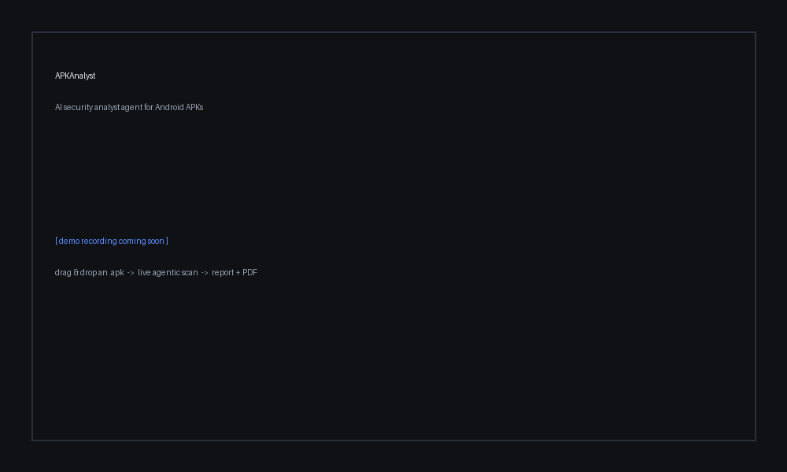

# APKAnalyst

**An AI security *analyst agent* for Android APKs.**

APKAnalyst takes an Android APK, autonomously investigates it for security
issues the way a human analyst would — it plans, runs real decompilers and
static-analysis tools, reasons about what it finds, grounds its conclusions in
real security standards, and produces a prioritized, structured report.

It is deliberately **not** "an AI scanner that pattern-matches." It is an
**agent**: it decides what to look at next, pulls apart native libraries,
verifies its own hypotheses with evidence, and cites the standard each finding
maps to instead of relying on the model's memory.

---

## Demo

Drag in an APK, pick a scan mode, and read the prioritized report in the browser
(with a one-click **Download PDF**):

<!-- Record against a self-built demo APK (not a copyrighted one) and save the
     clip to docs/demo.gif — it will render here on GitHub once committed. -->


### Run the web app locally

From inside `apk-analyst/`:

```bash
pip install -r requirements.txt
python3 -m uvicorn webapp.server:app --port 8077
```

Open <http://127.0.0.1:8077>. Provide an Anthropic API key either in a local
`.env` (`ANTHROPIC_API_KEY=...`) or by pasting one into the form per scan. For
agentic RAG grounding, also set `VOYAGE_API_KEY` and build the index once with
`python3 run.py --build-kb`. More detail in [`webapp/README.md`](webapp/README.md).

---

## Case study — does the agentic loop earn its cost?

A controlled, **blind** test on a real, obscure open-source app (no memorized
CVEs): both scan modes hit **3/3** known issues, but the agentic loop backed each
with quoted evidence, found **3 extra code-level bugs** (path-traversal bypass,
stored XSS, DoS) the manifest can't reveal, and **retracted a false positive** the
single-call pass asserted.

**→ [Read the full case study](docs/CASE_STUDY_lWS.md)**

---

## Try it on the bundled sample app

A purpose-built, intentionally-vulnerable app ships in [`sample-app/`](sample-app/)
so you can run a full scan against a **known ground truth** (11 planted vulns,
mapped to the OWASP Mobile Top 10):

```bash
python3 run.py sample-app/SecureVault.apk --agent
```

See [`sample-app/README.md`](sample-app/README.md) for the vulnerability table.

---

## Why this design

Decompiled APKs are large, messy, unstructured data — exactly where an LLM
agent earns its keep and a naive chatbot visibly fails. The methodology behind
mobile security assessment is ~90% *static* (decompile → read Java/smali/native
→ recognize a known pattern), which maps cleanly onto an agent with file and
search tools. APKAnalyst is **static-analysis-first**; a dynamic phase
(Frida/Burp) is a possible future extension.

---

## How it works

```
        APK
         │  decompile (jadx + apktool) · parse manifest · extract native strings
         ▼
   Extracted facts ──►  Agent (Claude, tool-driven loop)
                          │   tools: list_dir · read_file · grep ·
                          │          strings_in_lib · search_knowledge
                          │   grounded by ── RAG knowledge base
                          ▼
                   Structured JSON findings ──► prioritized report
```

The agent runs a **manual tool-use loop**: it is given a small seed view of the
APK plus a toolbox, and it decides what to read, grep, or disassemble next. When
it has investigated thoroughly it stops, and a final structured-output pass emits
the report against a strict schema (severity · OWASP Mobile category · CWE ·
location · evidence · exploit path · fix · cited standards).

### Grounding (RAG)

Findings are grounded in a local vector knowledge base with two roles:

- **Rulebook — OWASP MASVS.** The Mobile App Security Verification Standard
  controls, so a finding cites *what standard* it violates.
- **Playbook — analyst methodology.** A curated static-analysis methodology
  base (static analysis, malware analysis, OWASP Mobile Top 10, tooling) that
  guides *how to find and confirm* an issue.

Sources are embedded once with [Voyage AI](https://voyageai.com) and stored in a
small local numpy vector store; at analysis time the agent calls
`search_knowledge` to retrieve the most relevant control/notes by *meaning* and
records the citations on each finding.

---

## AI engineering demonstrated

| Technique | Where |
|---|---|
| LLM APIs & prompt engineering | `ai/analyst.py` — methodology encoded as a system prompt |
| Structured outputs (JSON schema) | `ai/models.py` — Pydantic `Finding` / `AnalysisReport` via `messages.parse` |
| Tool use / function calling | `ai/tools.py` — sandboxed toolbox with path-safety |
| Agentic loop | `ai/agent.py` — plan → call tools → observe → iterate |
| RAG (embeddings + vector store) | `knowledge/` — Voyage embeddings, cosine retrieval |
| Context management & prompt caching | `ai/context.py` — fact packing; `ai/caching.py` — cached static prefixes + rolling breakpoint |
| Reliability — broken-JSON recovery cascade | `ai/final_report.py` — local repair → cheap Haiku fix → gated re-run |
| Anti-hallucination — citation validation | `ai/citations.py` — drops any cited standard not in the corpus |
| Evals + LLM-as-judge | `eval/` — blind 6-app set; 6/6 recall, ~2.1% FP |

> **Deeper dive:** [`ENGINEERING.md`](ENGINEERING.md) explains each feature and
> optimization end-to-end — the agentic loop, the RAG rulebook/playbook split,
> prompt caching (and the honest measured cost), the recovery cascade, citation
> validation, and the eval/adjudication trust story.

---

## Layout

```
apk_analyst/
  decompile.py · manifest.py · natives.py · framework.py · pipeline.py   # Step 1: extraction
  ai/
    models.py      # structured-output schema
    context.py     # fact packing
    analyst.py     # Step 2: single structured LLM call
    agent.py       # Step 3: agentic tool-use loop
    tools.py       # the agent's toolbox (+ search_knowledge)
  knowledge/       # Step 4: RAG grounding
    corpus.py      # gather + chunk sources
    embedder.py    # Voyage embeddings (self-throttles on free tier)
    store.py       # local numpy vector store + cosine search
    build.py       # build the index
run.py             # CLI
```

---

## Setup

Requires Python 3.9+, and the external tools `jadx`, `apktool`, and `strings`
on your PATH.

```bash
pip install -r requirements.txt
cp .env.example .env        # then add your keys
```

`.env` needs:

- `ANTHROPIC_API_KEY` — runs the analyst agent.
- `VOYAGE_API_KEY` — embeds the knowledge base ([free tier](https://dashboard.voyageai.com/)
  is enough; the whole corpus is a one-time ~50K tokens).

Build the knowledge index once:

```bash
python3 run.py --build-kb
```

> The knowledge index and any fetched standards are git-ignored — rebuild them
> locally with the command above. The playbook is sourced from local
> methodology notes that are not distributed with the repo.

## Usage

```bash
# Step 1 — extraction only
python3 run.py APKs/YourApp.apk

# Step 2 — single-call structured analysis
python3 run.py APKs/YourApp.apk --ai

# Step 3+4 — grounded agentic investigation (recommended)
python3 run.py APKs/YourApp.apk --agent
```

Reports are written to `workspace/<AppName>/`.

---

## Example finding

```
[CRITICAL] Hardcoded AES key and IV in application resources (strings.xml)  (firm)
  M10: Insufficient Cryptography | CWE-798
  where : MainActivity.java (encrypt/decrypt) + res/values/strings.xml
  why   : Anyone with the APK reads the 16-byte key/IV and decrypts every
          message — local DB and network ciphertext alike. The "encryption"
          provides zero confidentiality against an attacker who holds the app.
  fix   : Remove key material from the APK; use the Android Keystore or a
          server-negotiated session key.
  cites : MASVS-CRYPTO · Course:Static — Exploiting Bad Cryptography
```

---

## Roadmap

- [x] **Step 1** — Extraction pipeline (decompile → manifest / permissions / native / code)
- [x] **Step 2** — Structured single-call analysis
- [x] **Step 3** — Agentic tool-use loop
- [x] **Step 4** — RAG grounding (MASVS rulebook + methodology playbook)
- [x] **Step 5** — Evals on known-vulnerable APKs: **6/6 recall (100%)**, false-positive rate **~2.1%** (blind, human-adjudicated)
- [ ] **Next** — HTML/PDF report export; context-management for very large codebases; MCP

---

## License

[PolyForm Noncommercial License 1.0.0](LICENSE.md) — free to view, use, and build
on for **noncommercial** purposes; all commercial rights reserved by the author.

---

*Agentic AI applied to a real, domain-specific problem: autonomous static
security analysis of Android APKs.*
